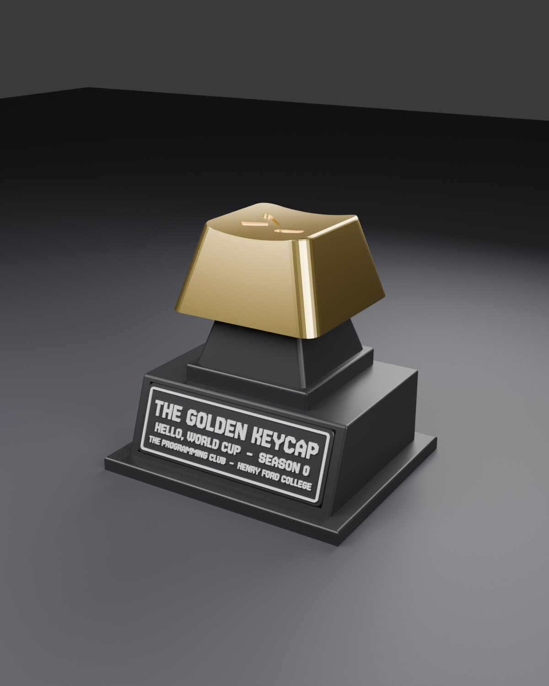
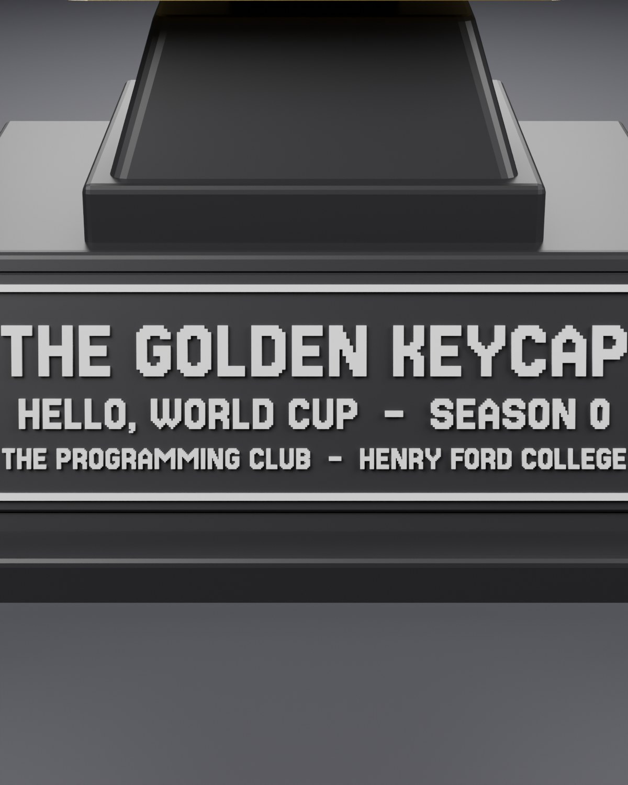
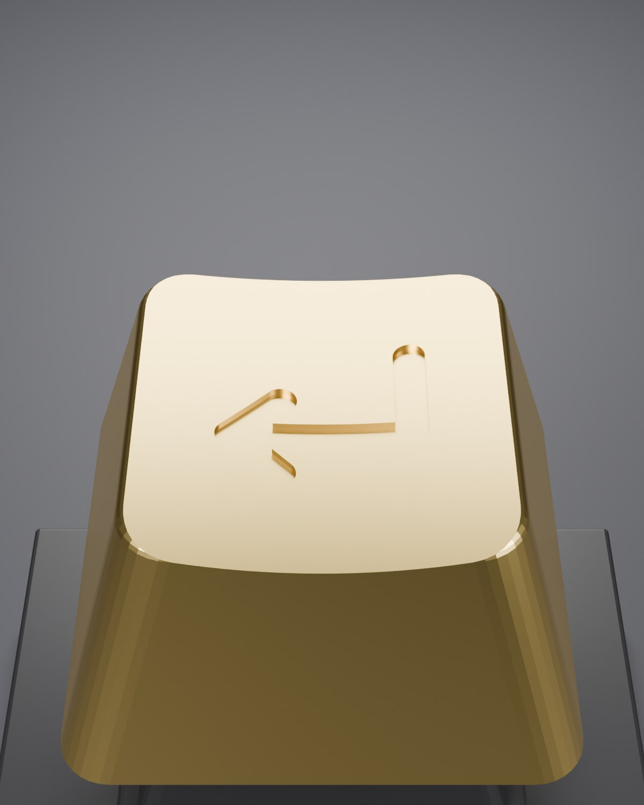

# The Golden Keycap

The Hello, World Cup trophy. A giant keycap engraved with an enter-key arrow (↵), spray-painted gold, sits on a giant mechanical-keyboard switch, which sits on a black plinth with the club plaque. Winners sign the keycap.



| Plaque                        | Keycap                        |
| ----------------------------- | ----------------------------- |
|  |  |

## Printing on the P1S

The trophy is printed as big as the P1S allows. The base, its biggest part, spans the 256 mm bed with 2 mm to spare, and every other part is scaled up by the same ×1.68 (`SCALE` in `build.py`). Each part needs a plate to itself.

Each black part has a sliced project for the P1S in black PLA, 0.20 mm Standard, 15% infill, no supports, on a Textured PEI Plate. Bambu's estimates:

| Part   | Project          | Size (mm)       | Time        | PLA   |
| ------ | ---------------- | --------------- | ----------- | ----- |
| Base   | `base-p1s.3mf`   | 252 × 208 × 104 | 10 h 20 min | 770 g |
| Keycap | `keycap-p1s.3mf` | 151 × 151 × 79  | 4 h 55 min  | 305 g |
| Switch | `switch-p1s.3mf` | 131 × 131 × 101 | 3 h 19 min  | 202 g |

That's about 18½ hours and 1.3 kg of black PLA, so have more than one 1 kg spool. The base sits back from the front edge to stay clear of the P1S's front-left exclusion zone.

The plaque (198 × 67 × 5.4 mm, roughly 45 g) prints separately: load `stl/plaque_plate.stl` and `stl/plaque_text.stl` together as one object with multiple parts, then give the text part white filament (or add a filament change at the first layer above 4.0 mm).

To lay out your own plates, open **`trophy-parts.3mf`** in Bambu Studio. Every part is its own object (the plaque with its text already set to white filament), set up for the P1S but not sliced. The STLs in `stl/` are there for reprinting one piece.

## Finishing and assembly

1. Spray-paint the keycap gold. Mask the engraved arrow first if you want it to stay black, or fill it with a black paint pen afterwards.
2. Glue the plaque into the pocket on the front of the base. Use CA glue or double-sided tape.
3. Drop the switch onto the two round pegs on top of the base. They sit centred on the top and keep the switch from turning.
4. Press the keycap onto the cross-shaped stem.

Each joint has 0.25 mm of clearance per side. Add a drop of glue if one feels loose. The finished trophy is about 235 mm tall. Winners sign the keycap with a paint pen.

## Editing

Every part is generated by `build.py` in Blender, using the site's pixel font (Jersey 15). To change the plaque text, edit `PLAQUE_LINES` near the top of `build.py`, then rebuild the STLs and the sliced projects:

```bash
/Applications/Blender.app/Contents/MacOS/Blender -b -P trophy/build.py            # STLs
/Applications/Blender.app/Contents/MacOS/Blender -b -P trophy/build.py -- render  # STLs + previews (~4 min)
for p in base switch keycap parts; do python3 trophy/make_3mf.py $p; done          # *-p1s.3mf, trophy-parts.3mf
```

`make_3mf.py` packs the STLs into a Bambu project and slices it (except `parts`) with Bambu Studio's own CLI and P1S presets. It needs Bambu Studio 2.8 or newer; the 2.4 CLI crashes. By default it uses a copy at `~/.local/share/bambu-cli/BambuStudio.app`, or pass the path to another `BambuStudio.app`.

The build script checks that every part is watertight before exporting it. The fonts in `fonts/` are under the SIL Open Font License.
